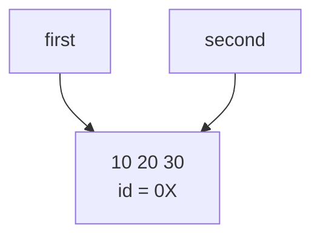
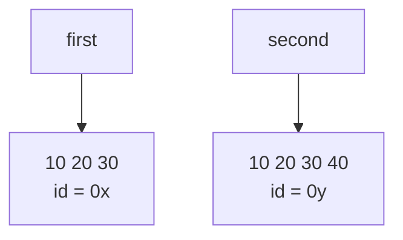

## Задание 1. Условия и классификация данных

### Эксперимент А. Неизменяемый объект
_Листинг кода:_
```python
a = 10
b = a

print(a, b)
print(id(a), id(b))

a += 1

print(a, b)
print(id(a), id(b))
```

Значение `b` не изменилось, потому что в Python целые исла относятся к неизменяемым типам данных, а значения являются
ссылками на ячейку в памяти. Поскольку `10` не изменяемый объект `a += 1` не может изменить его, тем самым не может продолжить
ссылаться на него, и `a` начинает ссылаться на него.

### Эксперимент B. Изменяемый объект
_Листинг кода:_
```python
# Эксперимент В
first = [10, 20]
second = first

print(first, second)
print(id(first), id(second))

second.append(30)

print(first, second)
print(id(first), id(second))
# Дополнение
second = [10, 20, 30]
print(first, second)
print(first == second)
print(first is second)
second.append(40)
print(first, second)
```
До переназначения:

После переназначения:


_Листинг кода практической задачи:_
```python
conf1 = ['Проект', ['Сергей', 'Егор'], [100, 0]]
conf2 = conf1

print('До изменения:')
print('conf1 = ', conf1)
print('conf2 = ', conf2)

conf2[1].append('Влад')
conf2[2][0] = 200

print('\nПосле изменения:')
print('conf1 = ', conf1)
print('conf2 = ', conf2)

conf3 = ['Проект', ['Сергей', 'Егор'], [100, 0]]
conf1[1].append("Лиза")
conf1[2][0] = 200

assert conf1 is not conf3
assert conf1[1] is not conf3[1]
assert conf1[2] is not conf3[2]
assert "Лиза" not in conf3[1]
assert conf1[2][0] == 200
assert conf3[2][0] == 100
print("\nПервая конфигурация (зависимая с conf2): ", conf1)
print("Независимая конфигурация: ", conf3)
```
_Вывод практической задачи:_
```
До изменения:
conf1 =  ['Проект', ['Сергей', 'Егор'], [100, 0]]
conf2 =  ['Проект', ['Сергей', 'Егор'], [100, 0]]

После изменения:
conf1 =  ['Проект', ['Сергей', 'Егор', 'Влад'], [200, 0]]
conf2 =  ['Проект', ['Сергей', 'Егор', 'Влад'], [200, 0]]

Первая конфигурация (зависимая с conf2):  ['Проект', ['Сергей', 'Егор', 'Влад', 'Лиза'], [200, 0]]
Независимая конфигурация:  ['Проект', ['Сергей', 'Егор'], [100, 0]]
```
_Вопросы для анализа:_
1) Нет, не меняет. Объект `second` начинает ссылаться еа тот же объект в памяти, что и `first`.
2) Значение не изменяемого объекта нельзя изменить, поэтому при изменении значения создается новая ячейка в памяти, на 
которую начинает ссылаться переменная.
3) Чтобы определить являются ли два объекта одним (ссылаются на одну и туже ячейку в памяти), используът оператор `is`.

## Задание 2. Поверхностное и глубокое копирование
_Листинг кода:_
```python
import copy


def print_info(step_name, structures):
    print(f"\n{'=' * 20} {step_name} {'=' * 20}")
    for name, obj in structures.items():
        ext_id = id(obj)
        nested_id = id(obj[0]) if len(obj) > 0 else "N/A"
        grade_id = id(obj[0][1]) if len(obj) > 0 and len(obj[0]) > 1 else "N/A"

        print(f"\n[{name.upper()}]: {obj}")
        print(f"  • id внешнего списка:          {ext_id}")
        print(f"  • id первого вложенного списка: {nested_id}")
        print(f"  • id первой оценки (obj[0][1]): {grade_id}")


# 1. Инициализация исходных структур
original = [
    ["Python", 5],
    ["Algorithms", 4],
]
alias = original
shallow = original.copy()
deep = copy.deepcopy(original)

structures = {
    "original": original,
    "alias": alias,
    "shallow": shallow,
    "deep": deep,
}

print_info("Исходное состояние", structures)

# 2. Первое изменение: добавление элемента во внешний список
original.append(["Databases", 5])
print_info("После: original.append(['Databases', 5])", structures)

# 3. Второе изменение: модификация вложенного изменяемого объекта
original[0][1] = 3
print_info("После: original[0][1] = 3", structures)
```
| Операция | Новый внешний объект          | Новые вложенные объекты       | Изменения независимы                                         |
|---|-------------------------------|-------------------------------|--------------------------------------------------------------|
| Присваивание | нет (ссылка на тот же объект) | нет (ссылка на тот же объект) | Полностью зависимы                                           |
| Поверхностная копия | да (новая ссылка на объект)   | нет (ссылка на тот же объект) | Частично зависимы (добавление изолировано, но изменения нет) |
| Глубокая копия | да (новая ссылка на объект)   | да (новая ссылка на объект)   | Полность независимы                                          |

_Листинг кода:_
```python
wrong_matrix = [[0] * 3] * 3
wrong_matrix[0][0] = 1
print(f"wrong_matrix:   {wrong_matrix}")
print(f"id строк wrong_matrix:   {[id(row) for row in wrong_matrix]} (все id совпадают)")

correct_matrix = [[0] * 3 for _ in range(3)]
correct_matrix[0][0] = 1
print(f"correct_matrix: {correct_matrix}")
print(f"id строк correct_matrix: {[id(row) for row in correct_matrix]} (каждая строка уникальна)")
```
_Объяснение различий результатов у матриц:_
1) `wrong_matrix = [[0] * 3] * 3` внутреннее выражение `[0] * 3` создает один единственный объект списка. Внешний оператор 
умножения `* 3` не клонирует его, а трижды копирует одну и ту же ссылку. В результате `wrong_matrix` содержит три ссылки
на одну и ту же ячейку в памяти. Модификация `wrong_matrix[0][0]` меняет этот общий объект, из-за чего значение визуально
меняется во всех трех строках сразу.
2) `correct_matrix = [[0] * 3 for _ in range(3)]` генератор списка на каждой итерации цикла заново вычисляет выражение `[0] * 3`, 
создавая в памяти три отдельных независимых списка. Изменение элемента `correct_matrix[0][0]` затрагивает только первый список.

_Вопросы для анализа:_
1) Поверхностная копия создает новый внешний контейнер с новой ячейкой в памяти, но элементы внутри внешнего контейнера
имеют те же самые ссылки, что и объекты в исходном контейнере. Изменение внутренних элементов отразиться на обеих контейнерах. 
Глубокая копия создает как новый внешний контейнер с новой ссылкой на ячейку в памяти, так и новые внутренние объекты с новыми ссылками.
В результате получается полностью автономная структура.
2)  - Высокие накладные расходы по ресурсам: рекурсивный обход требует значительно больше процессорного времени и выделения оперативной памяти.
    - Избыточность: многие объекты в структурах (числа, строки, кортежи с неизменяемыми данными) неизменяемы по своей природе — дублировать их бессмысленно и неэффективно.
3) Когда требуется изолировать только состав или порядок элементов во внешнем списке (добавление, удаление, 
сортировка, фильтрация), не модифицируя при этом внутреннее состояние самих элементов.

## Задание 3. Подсчет ссылок и время жизни объекта
_Листинг кода:_
```python
import sys

data = [1, 2, 3]
print("После создания:", sys.getrefcount(data))

alias = data
print("После создания alias:", sys.getrefcount(data))

container = [data]
print("После помещения в контейнер:", sys.getrefcount(data))

del alias
print("После del alias:", sys.getrefcount(data))

container.clear()
print("После очистки контейнера:", sys.getrefcount(data))

print('=' * 20)
# Дополнительная программа со слабой ссылкой
import weakref

class Record:
    pass

record = Record()
weak_record = weakref.ref(record)

print(weak_record())
del record
print(weak_record())

print('=' * 20)
```
1) Так как передача переменной `data` в качестве аргумента временно создаёт временную ссылку.
2) Переменные, которые увеличивают счётчик: присваивание `alias = data`, добавление объекта в список, словарь, кортеж, множество
`container = [data]`, предача в функцию как аргумент
3) Переменные, которые уменьшают счётчик: удаление имени переменной через `del`, переопределение переменной: если переменной
присвоить другое значение (`data = None` или `alias = 10`) старая ссылка теряется, удаление из коллекций/очистка: `container.clear()`
4) В Python инструкция del управляет пространством имен, а не непосредственно выделенной памятью. del alias удаляет запись
alias из текущей таблицы символов (словаря локальных или глобальных переменных) и декрементирует счетчик ссылок целевого объекта на единицу.

Слабая ссылка не продлевает жизнь объекта, потому что Python считает объект нужным только до тех пор, пока на него есть 
хотя бы один «полноценный владелец» (сильная ссылка), а слабая ссылка владельцем не является.

### Практическая задача
_Листинг кода:_
```python
import weakref
class Record:
    def __init__(self, name):
        self.name = name


registry = weakref.WeakValueDictionary()

r1 = Record("первая")
r2 = Record("вторая")
temp = Record("третья")

registry["r1"] = r1
registry["r2"] = r2
registry["r3"] = temp

print("Сначала:", sorted(registry.keys()))

del temp
print("После del temp:", sorted(registry.keys()))

del r2
print("После del r2:", sorted(registry.keys()))
```
_Вопросы для анализа:_
1) Подсчет ссылок позволяет освободить объект, когда счетчик сильных ссылок равен 0.
2) Нет. Освобождённая память чаще всего возвращается не в ОС, а во внутренний пул Python и там используется повторно для новых объектов.
3) 	
| Признак | Сильная ссылка | Слабая ссылка |
|---|---|---|
| Увеличивает счётчик ссылок | Да | Нет |
| Удерживает объект в памяти | Да | Нет |
| При уничтожении объекта | Объект уничтожить нельзя, пока ссылка есть | Ссылка становится «мёртвой» (`ref()` возвращает `None`), запись в `WeakValueDictionary` исчезает |
| Как создаётся | Обычное присваивание: `a = obj` | `weakref.ref(obj)`, `WeakValueDictionary` и др. |


## Задание 4 Циклические ссылки и сборщик мусора
_Листинг кода:_
```python
import gc

gc.collect()

first = []
second = []

first.append(second)
second.append(first)

print("first ссылается на second:", first[0] is second)
print("second ссылается на first:", second[0] is first)

# Состояние сборщика мусора
print("\nАвтоматический сборщик включён:", gc.isenabled())
print("Пороги поколений:", gc.get_threshold())
print("Текущие счётчики поколений:", gc.get_count())
print("Статистика поколений:")
for number, stats in enumerate(gc.get_stats()):
    print(f"  поколение {number}: {stats}")

# 1. Запоминаем идентификаторы
first_id = id(first)
second_id = id(second)
print("\nid(first):", first_id)
print("id(second):", second_id)


def alive(object_id):
    return any(id(obj) == object_id for obj in gc.get_objects()) # Проверяет, есть ли объект с таким id среди объектов, отслеживаемых gc.


# 2. Удаляем имена
del first
del second
print("\nИмена first и second удалены")
print("Список first ещё в памяти:", alive(first_id))
print("Список second ещё в памяти:", alive(second_id))

# 3. Запускаем сборщик
collected = gc.collect()
print("\ngc.collect() вернул:", collected)
print("Список first ещё в памяти:", alive(first_id))
print("Список second ещё в памяти:", alive(second_id))
```
4) почему одного подсчета ссылок недостаточно для удаления созданного цикла: после del first и del second исчезли только имена.
Но сами списки по-прежнему ссылаются друг на друга: first[0] указывает на second, а second[0] на first. Поэтому у каждого 
списка счётчик ссылок равен 1, а не 0. Каждый список «держит» другой, и ни один счётчик не может упасть до нуля.
5) Назначение поколений сборщика мусора без привязки к конкретным значениям порогов: поколения построены на наблюдении, что
большинство объектов живут очень недолго: временные списки, промежуточные результаты и т. п. Долгоживущие объекты 
(модули, классы, глобальные структуры) встречаются реже и обычно живут до конца программы.

_Эксперимент листинг кода:_
```python
import gc
import weakref


class Node:
    def __init__(self):
        self.other = None

alive = weakref.WeakSet()


def make_cycle():
    a = Node()
    b = Node()
    a.other = b
    b.other = a
    alive.add(a)
    alive.add(b)
    return a, b


gc.collect()  # чистим мусор, накопившийся до эксперимента

print("Автоматический сборщик включён:", gc.isenabled())
gc.disable()
try:
    print("Автоматический сборщик отключён:", not gc.isenabled())

    for _ in range(5):
        make_cycle()

    print("\nЦиклов создано: 5, узлов должно быть 10")
    print("Узлов в памяти после удаления внешних ссылок:", len(alive))

    collected = gc.collect()
    print("\ngc.collect() вернул:", collected)
    print("Узлов в памяти после gc.collect():", len(alive))
finally:
    # Автоматическая сборка восстанавливается, даже если произошла ошибка
    gc.enable()

print("\nАвтоматический сборщик снова включён:", gc.isenabled())
```
_Вывод:_
```
Эксперимент
Автоматический сборщик включён: True
Автоматический сборщик отключён: True

Циклов создано: 5, узлов должно быть 10
Узлов в памяти после удаления внешних ссылок: 10

gc.collect() вернул: 20
Узлов в памяти после gc.collect(): 0

Автоматический сборщик снова включён: True
```

_Практическое задание листинг кода:_
```python
import gc
gc.collect()
gc.disable()

print("Собрано до создания графа:", gc.collect())

a = {"name": "A", "links": []}
b = {"name": "B", "links": []}
c = {"name": "C", "links": []}
d = {"name": "D", "links": []}

a["links"].append(b)  # A -> B
b["links"].append(c)  # B -> C
c["links"].append(a)  # C -> A

for node in (a, b, c, d):
    print(node["name"], "->", [n["name"] for n in node["links"]])

del a, b, c
print("Собрано после удаления графа:", gc.collect())

print("D доступен:", d["name"], d["links"])

gc.enable()
```
_Вывод:_
```
Собрано до создания графа: 0
A -> ['B']
B -> ['C']
C -> ['A']
D -> []
Собрано после удаления графа: 6
D доступен: D []

```
_Вопросы для анализа:_
1) Циклическая ссылка возниакает, когда два объекта ссылаются друг на друга, не давая обнулить себя.
2) Счётчик считает ссылки, но не проверяет, откуда они идут. В цикле каждый узел имеет счётчик 1, потому что на него ссылается
соседний узел. Но сам цикл целиком отрезан от программы: после del не осталось ни одного имени, с которого можно дойти до A, B или C. 
Объекты держат только друг друга, а доступа к ним у программы нет.
3) Это нужно для того, чтобы не проверять все объекты каждый раз. Большинство объектов живёт недолго, а те, что пережили 
несколько проверок, скорее всего проживут ещё долго. Поэтому молодое поколение проверяется часто и дёшево, а старые поколения реже

## Задание 5 Исследование потребления памяти    
### Часть 1
_Листинг кода:_
```python
import sys

empty_list = []
list_10 = list(range(10))
tuple_10 = tuple(range(10))
str_10 = "abcdefghij"
num = 42
none_obj = None

print("Пустой список: ", sys.getsizeof(empty_list))
print("Список из 10 int: ", sys.getsizeof(list_10))
print("Кортеж из 10 int: ", sys.getsizeof(tuple_10))
print("Строка из 10 симв.: ", sys.getsizeof(str_10))
print("Целое число: ", sys.getsizeof(num))
print("None: ", sys.getsizeof(none_obj))
```
_Почему размер контейнера не включает размеры содержимого?_
sys.getsizeof() возвращает только память, занятую самим объектом, то есть его собственной структурой. Контейнеры 
(список, кортеж, словарь) хранят не сами объекты, а ссылки (указатели) на них. На 64-битной системе каждая ссылка занимает 8 байт, независимо от того, на что она указывает.

### Часть 2
_Листинг кода:_
```python
import sys

lst = []
last_size = sys.getsizeof(lst)
print(f"len={len(lst):3d}  size={last_size:4d}  (ёмкость ≈ {(last_size - 56) // 8})")

for i in range(100):
    lst.append(i)
    size = sys.getsizeof(lst)
    if size != last_size:
        print(f"len={len(lst):3d}  size={size:4d}  (ёмкость ≈ {(size - 56) // 8})")
        last_size = size
```
1. Увеличивается ли размер после каждого append()?

Нет. Размер растёт скачками: например, при длине от 1 до 4 он остаётся 88 байт, а от 5 до 8 равен 120. Новая память
запрашивается только тогда, когда свободные слоты закончились.

2. Почему список резервирует место с запасом?

Список хранит элементы в одном непрерывном блоке памяти. Если бы он выделял ровно столько, сколько нужно, то каждый 
append() требовал бы realloc и, возможно, копирования всего блока, то есть добавление n элементов стоило бы O(n²). 
CPython при нехватке места увеличивает ёмкость примерно на 12,5% плюс небольшую константу. Ёмкость растёт пропорционально длине, 
поэтому перевыделения происходят всё реже, и в среднем append() выполняется за амортизированное O(1). Плата за это в том, что часть памяти временно простаивает.

3. Чем длина отличается от объёма выделенной памяти?

Длина (len(lst)) показывает, сколько элементов реально лежит в списке.
Объём памяти (sys.getsizeof(lst)) включает заголовок объекта и весь выделенный буфер ссылок, в том числе пока пустые слоты.

### Часть 3
_Листинг кода:_
```python
import tracemalloc

# Вариант 1: список
tracemalloc.start()
numbers = list(range(100_000))
current, peak = tracemalloc.get_traced_memory()
tracemalloc.stop()
print("list(range(100_000)):")
print("  текущая:", current / 1024, "КБ")
print("  пиковая:", peak / 1024, "КБ")

# Вариант 2: range
tracemalloc.start()
numbers = range(100_000)
current, peak = tracemalloc.get_traced_memory()
tracemalloc.stop()
print("range(100_000):")
print("  текущая:", current / 1024, "КБ")
print("  пиковая:", peak / 1024, "КБ")
```
_Вывод различий:_

list(range(100_000)) создаёт материализованную последовательность: все 100 000 значений реально существуют в памяти, 
каждое как отдельный объект int, а список хранит ссылки на них. Расход памяти растёт линейно с количеством элементов.

range(100_000) хранит правило получения значений: только три числа (start, stop, step) и длину. Элемент с индексом i 
вычисляется по формуле start + i * step в момент обращения и нигде заранее не хранится. Поэтому размер range не зависит 
от того, сколько в нём «элементов»: range(10) и range(10**12) занимают одинаково мало.

## Итоговый анализ
Способы для уменьшения потребления памяти:
1) Использование слабых ссылок (задание 3)
2) Периодический запуск gc.collect() для избавления от циклических ссылок(задание 4).
3) Использование объектов, которые хранят правило получения значений, вместо материализованных последовательностей(задание 5, часть 3)
4) Не плодить лишние копии: присваивание или поверхностная копия вместо глубокой(задание 2)

## Практическая задача
Соберем утилиту со значениями:
- название сценария;
- число элементов;
- размер внешнего объекта;
- текущий и пиковый объем выделенной памяти;
- отношение пикового объема двух сравниваемых сценариев

_Листинг кода:_
```python
# 1
import sys

empty_list = []
list_10 = list(range(10))
tuple_10 = tuple(range(10))
str_10 = "abcdefghij"
num = 42
none_obj = None

sizes = [
    {"scenario": "пустой список", "count": len(empty_list), "size": sys.getsizeof(empty_list)},
    {"scenario": "список из 10 чисел", "count": len(list_10), "size": sys.getsizeof(list_10)},
    {"scenario": "кортеж из 10 чисел", "count": len(tuple_10), "size": sys.getsizeof(tuple_10)},
    {"scenario": "строка из 10 символов", "count": len(str_10), "size": sys.getsizeof(str_10)},
    {"scenario": "целое число", "count": 1, "size": sys.getsizeof(num)},
    {"scenario": "None", "count": 1, "size": sys.getsizeof(none_obj)},
]

# 2
lst = []
last_size = sys.getsizeof(lst)
grow = [{'length': len(lst), 'size': last_size, 'diff': 0}]
for i in range(100):
    lst.append(i)
    size = sys.getsizeof(lst)
    if size != last_size:
        grow.append({'length': len(lst), 'size': size, 'diff': size - last_size})
        last_size = size

# 3
import tracemalloc

# Вариант 1: список
traced = []

tracemalloc.start()
numbers = list(range(100_000))
current, peak = tracemalloc.get_traced_memory()
traced.append({"scenario":'list(range(100_000))', "count":len(numbers), "size":sys.getsizeof(numbers), 'cur_b':current, 'peak_b':peak})
tracemalloc.stop()

tracemalloc.start()
numbers2 = range(100_000)
current2, peak2 = tracemalloc.get_traced_memory()
traced.append({"scenario":'range(100_000)', "count":len(numbers2), "size":sys.getsizeof(numbers2), 'cur_b':current2, 'peak_b':peak2})
tracemalloc.stop()

peak_ratio = traced[0]["peak_b"] / traced[1]["peak_b"]

# Вывод отчета

print("Часть 1. Размеры отдельных объектов")
for row in sizes:
    print(row["scenario"],'| элементов: ',  row["count"], '| размер в байтах: ', row["size"])

print()

print("Часть 2. Рост списка")
for row in grow:
    print('длина: ', row['length'], "| размер в байтах:", row['size'], '| разница с предыдущим:', row['diff'])

print()

print("Часть 3. Измерение через tracemalloc")

for row in traced:
    print(row['scenario'], '| элементов: ',  row["count"],'| размер в байтах: ', row["size"])
    print("Current memory: %.2f KB" % (row["cur_b"]/1024))
    print("Peak memory:    %.2f KB" % (row["peak_b"]/1024))
    print()
print("Отношение пиковых объемов (list / range): %.1f" % peak_ratio)
```

## Итоговый вывод о наиболее опасных ошибках при работе с изменяемыми объектами
Самые опасные ошибки при работе с изменяемыми объектами возникают из-за того, что переменная хранит ссылку, а не сам объект, 
поэтому изменение через одно имя видно через все остальные. Типичные случаи: присваивание b = a вместо копирования,
поверхностная копия вложенных структур, создание матрицы через [[0] * 3] * 3 и изменяемое значение по умолчанию в аргументах 
функции (def f(x=[])). К ним добавляются изменение коллекции во время обхода и неявное изменение аргументов, переданных в функцию.
Чтобы их избежать, нужно копировать осознанно (copy или deepcopy), использовать неизменяемые типы там, где данные не должны меняться, 
и всегда помнить, сколько ссылок указывает на объект.


